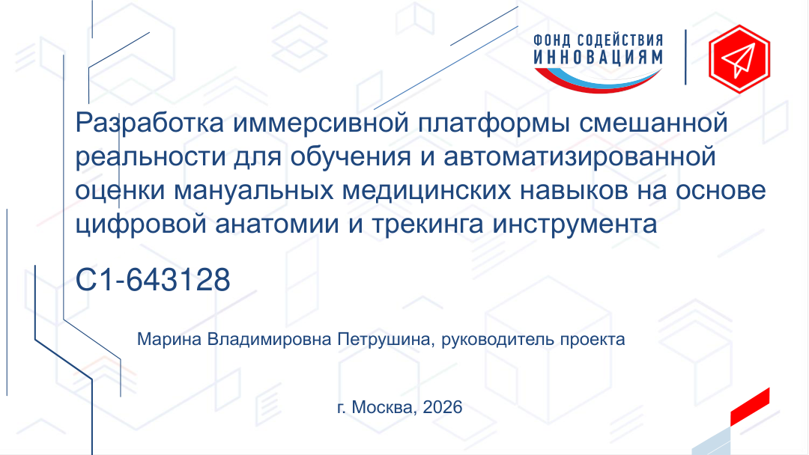
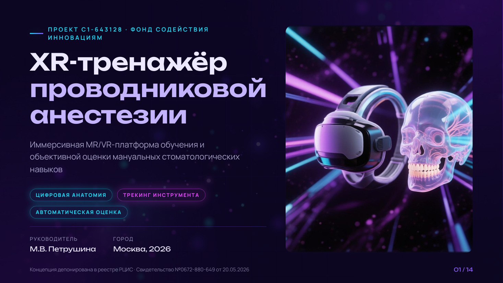
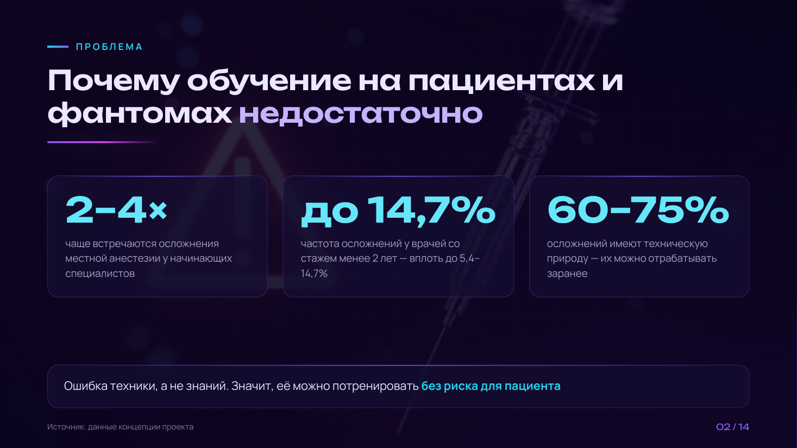
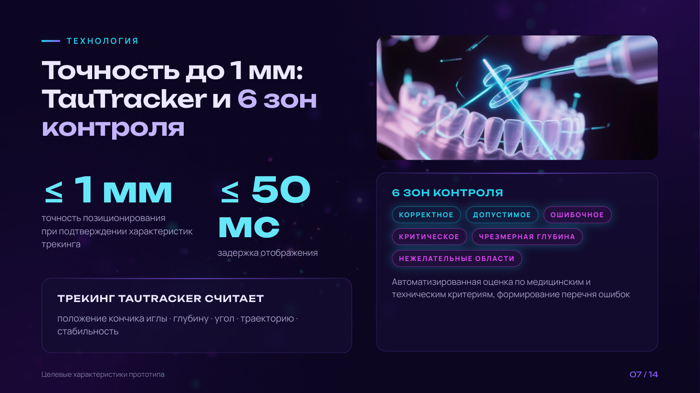
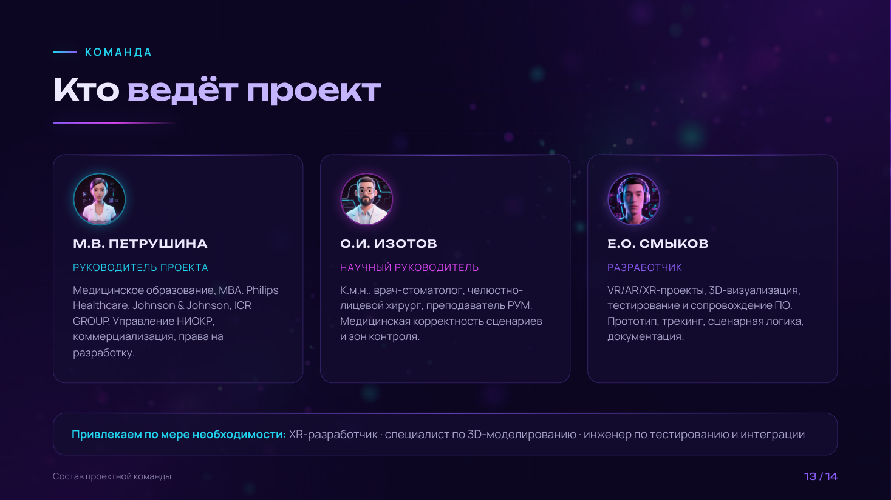
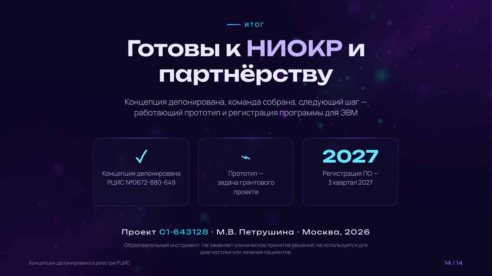

# XR-тренажёр проводниковой анестезии — редизайн презентации для ФСИ

Редизайн грантовой презентации проекта **C1-643128** (Фонд содействия инновациям):
MR/VR-платформа обучения и автоматизированной оценки мануальных стоматологических
навыков. 14 слайдов 16:9 в тёмном неоновом стиле — от референса Metaverse/VR
до готового PDF с генеративными иллюстрациями.

**Кейс:** структура и тексты по методике продающих презентаций → редактура →
визуальная концепция → сборка HTML/PDF → пакет промптов для генерации визуалов.
**Стоимость: 5 000 ₽.**

## Было → Стало

| Было (оригинал) | Стало (редизайн) |
| --- | --- |
|  |  |

Исходник: светлый корпоративный шаблон, стоковые фото, «стены текста»,
заголовок обложки 26 слов, дисклеймер на каждом слайде.
Результат: единая тёмная неоновая система, один слайд — одна мысль,
заголовки ≤ 10 слов, факты и цифры сохранены дословно.

## Скриншоты

| Проблема | Технология |
| --- | --- |
|  |  |

| Команда | Итог |
| --- | --- |
|  |  |

Все 14 слайдов — в папке [`preview/`](preview/).

## Состав

| Файл | Что это |
| --- | --- |
| `presentation.pdf` | Готовая презентация 14 слайдов, 16:9 (5 МБ) |
| `index.html` + `styles.css` | Живая версия: навигация стрелками ←/→, пересборка PDF из браузера |
| `assets/` | 16 иллюстраций (нейросеть): обложка, MR-сцена, HUD-игла, дашборд, аватары, фоны |
| `docs/01-structure.md` | Рабочее ТЗ (10 полей) и таблица слайдов: № / функция / заголовок / мысль / доказательство / визуал |
| `docs/02-texts.md` | Редактура «Было → Стало → Почему» по каждому слайду |
| `docs/03-prompts.md` | Библиотека промптов для генерации всех визуалов (Midjourney/Flux/DALL·E) |
| `preview/` | PNG-превью всех 14 слайдов |
| `screenshots/` | Изображения для README |

## Как посмотреть

1. **PDF:** открыть `presentation.pdf`.
2. **Живая версия:** открыть `index.html` в браузере, листать стрелками ←/→.
3. **Свой PDF:** `index.html` → Ctrl+P → «Сохранить как PDF»
   (поля: нет, фоновая графика: вкл).

## Дизайн-система

- **Стиль:** тёмный tech-neon, голографическая анатомия (референс: VR/метавселенная)
- **Палитра:** фон `#0B0620` · фиолет `#8B5CF6` · маджента `#D946EF` ·
  циан `#22D3EE` · текст `#EDE9FE` / `#A5A0C8`
- **Шрифты:** Unbounded (заголовки) + Manrope (текст), оба с кириллицей
- **Фон всех слайдов:** сгенерированное боке с затемняющим слоем 78–88%
- **Изображения:** без текста на картинке, неоновая обводка, 16:9

## Как пересобрать

PDF генерируется headless Chromium:

```bash
msedge --headless=new --disable-gpu --user-data-dir=<профиль> `
  --no-pdf-header-footer --virtual-time-budget=10000 `
  --print-to-pdf=presentation.pdf "file:///.../index.html"
```

Превью PDF → PNG: `pymupdf` (скрипт `render_preview.py` из рабочей папки).

## Структура презентации (методика)

Обложка → боль (2–4×, до 14,7%, 60–75%) → решение (смешанная реальность) →
состав комплекса → 5 шагов сессии → режимы → точность (≤1 мм, ≤50 мс, 6 зон) →
панель преподавателя → архитектура → рынок ($401,8→701,1 млн) → выгоды и
нормативка (ФГОС, профстандарт, приказ 709н) → план (регистрация ПО, 3 кв. 2027) →
сравнение с аналогами → команда → вывод.

---

Часть портфолио: [mary-rnd.github.io/portfolio](https://mary-rnd.github.io/portfolio/)
